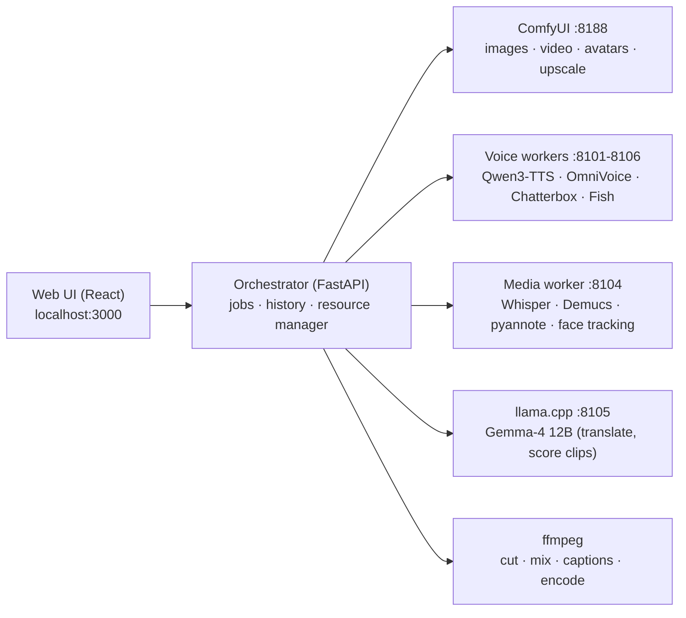

<div align="center">


# LocalAI Studio

**Your own HeyGen + OpusClip + ElevenLabs — running 100 % on your PC.**
Images · video with sound · avatars with lip sync · video translation & dubbing · viral clips · voice cloning


[Quick start](#-quick-start) · [Is my PC powerful enough?](#%EF%B8%8F-is-my-pc-powerful-enough) · [Install with an AI agent](docs/AI_INSTALL_PROMPT.md) · [Models](docs/MODELS.md) · [Troubleshooting](docs/TROUBLESHOOTING.md) · [Русский](README.ru.md)

</div>

---

## ✨ What it does

| | |
|---|---|
| 🖼️ **Images** | Text-to-image (Z-Image Turbo), instruction editing (Qwen-Image-2.1, FLUX.2 klein), inpainting, LoRA, SeedVR2 / Real-ESRGAN upscaling, background removal |
| 🎬 **Video** | LTX-2.5 text/image-to-video **with synchronized sound**, HunyuanVideo 1.5, video editing by instruction (Bernini-R, VACE), upscaling, frame interpolation (RIFE) |
| 🧑‍💼 **Avatars** | Talking photo/video avatars with lip sync (InfiniteTalk), saved avatar library |
| 🌍 **Translate & dub** | Whisper transcription → local LLM translation → voice cloning per speaker → background music preserved → optional lip sync and subtitles. Review every line before rendering |
| ✂️ **Clips** | OpusClip-style: finds the best moments of a long video, scores them, reframes to 9:16 with face tracking, word-by-word captions, auto headline, HD export |
| 🎙️ **Voice** | 4 TTS engines (Qwen3-TTS, OmniVoice, Chatterbox, Fish S2 Pro), cloning from 5–15 s, voice library, benchmark-driven *Auto* engine per language |
| 🧭 **Studio** | Live VRAM/RAM panel per model, one-click *Free RAM*, history with prompts & seeds, model manager, Russian/English UI, YouTube links as input |

Everything runs on `127.0.0.1`. No account, no cloud, no telemetry, no watermarks added by LocalAI.

---

## ⚠️ Is my PC powerful enough?

LocalAI runs very large models (6–22 billion parameters). **Please check this table before installing.**
The installer measures your PC first and refuses to continue on hardware that cannot work.

| | Minimum (LITE) | Recommended (FULL) |
|---|---|---|
| **GPU** | NVIDIA RTX 20-series or newer, **8 GB VRAM** | **NVIDIA RTX 50-series, 16 GB VRAM** (e.g. RTX 5080 / 5090) |
| **Driver** | 580 or newer | latest Game Ready / Studio |
| **RAM** | 16 GB | **32 GB** or more |
| **Disk (C:)** | 120 GB free, SSD | **300 GB free**, NVMe SSD |
| **OS** | Windows 10 22H2 (64-bit) | Windows 11 |
| **What works** | images + voice (slower) | everything |

| Your GPU | Images | Voice | Clips / dubbing | Avatars & lip sync | Video generation / editing |
|---|:-:|:-:|:-:|:-:|:-:|
| 8–11 GB VRAM | 🟡 slow | ✅ | ✅ | ❌ | ❌ |
| 12–15 GB VRAM | ✅ | ✅ | ✅ | 🟡 very slow | 🟡 very slow / may fail |
| 16 GB+, RTX 40-series | ✅ | ✅ | ✅ | ✅ | 🟡 no NVFP4 → LTX-2.5 not recommended |
| **16 GB+, RTX 50-series** | ✅ | ✅ | ✅ | ✅ | ✅ |

> [!WARNING]
> • **AMD / Intel GPUs and Macs are not supported** (CUDA only).
> • Video generation keeps the GPU at 100 % for minutes: expect heat, fan noise and 300–450 W power draw. Laptops must be plugged in.
> • A full install downloads **~230 GB** of models; on a 100 Mbit/s connection that is about 5–6 hours.
> • LTX-2.5 is distributed in **NVFP4**, which only RTX 50-series (Blackwell) GPUs run natively.

Check your PC without installing anything:

```powershell
powershell -ExecutionPolicy Bypass -File C:\LocalAI\install.ps1 -CheckOnly
```

---

## 🚀 Quick start

```bash
git clone https://github.com/<owner>/localai-studio.git C:\LocalAI
```

1. Double-click **`C:\LocalAI\Install-LocalAI.bat`**
   It checks your hardware, installs portable tools into `C:\LocalAI\apps` (nothing system-wide), creates the
   Python environments from exact lock files, builds the UI, lets you pick a model profile and downloads it.
2. Double-click the **LocalAI Studio** icon on your desktop.
3. Open **http://localhost:3000**

| Model profile | Download | For |
|---|---|---|
| `starter` | ~62 GB | images, voice, clips, dubbing, local LLM |
| `video` | ~122 GB | + LTX-2.5 video with sound, avatars with lip sync |
| `full` | ~231 GB | + Qwen-Image editor, Bernini-R / VACE video editing, HunyuanVideo 1.5, Fish S2 Pro |

The installer is safe to re-run: it skips finished steps and resumes interrupted downloads.
Some models are *gated* — the installer tells you which Hugging Face pages to accept (free account).

### 🤖 Prefer an AI agent to do it?

Open Claude Code (or another coding agent) in `C:\LocalAI` and paste the prompt from
**[docs/AI_INSTALL_PROMPT.md](docs/AI_INSTALL_PROMPT.md)**. It checks your hardware first, warns you about
what your PC can't do, follows strict safety rules (no driver/BIOS/system changes, official sources only,
asks before every download > 15 GB) and already knows every pitfall we hit.

---

## 🏗️ How it works



- **One GPU, many models.** A resource manager loads one heavy model family at a time and unloads the others
  before a job (modes: *Auto*, *Keep loaded*, *Low VRAM*). Out-of-memory jobs retry once in low-VRAM mode.
- **Isolated environments.** Every engine has its own Python environment because they pin conflicting
  versions of torch/transformers. Exact package lists live in [`requirements/`](requirements).
- **Everything local.** All services bind to `127.0.0.1`; outputs, history and voices stay in `C:\LocalAI`.

<details>
<summary><b>Folder layout</b></summary>

```
C:\LocalAI
├─ Install-LocalAI.bat · Start-LocalAI.bat · Stop-LocalAI.bat · HF-Login.bat
├─ api\          orchestrator (FastAPI): jobs, workflows, dubbing, clips, avatars, resource manager
├─ workers\      voice (TTS) and media workers
├─ ui\           web interface (React + Vite)
├─ config\       presets, model manifest, ComfyUI model paths
├─ requirements\ exact package lock per Python environment
├─ scripts\      start/stop, installer helpers, model downloader, tests & benchmarks
├─ docs\         AI install prompt, models, troubleshooting
├─ voices\       built-in default voices
│  -- created by the installer / at runtime (not in git) --
├─ apps\         ComfyUI, ffmpeg, llama.cpp, Python, uv, yt-dlp, deno
├─ envs\         Python environments
├─ models\       model weights
├─ outputs\      your results, one folder per feature (images, clips, dubbing, …)
└─ data\ logs\   history database, projects, logs
```
</details>

<details>
<summary><b>Ports</b> (127.0.0.1 only)</summary>

UI 3000 · API 8000 · ComfyUI 8188 · Chatterbox 8101 · Qwen3-TTS 8102 · OmniVoice 8103 · Media 8104 · LLM 8105 · Fish 8106.
If a port is busy, LocalAI picks the next free one.
</details>

---

## 🛡️ Privacy & responsible use

- No telemetry, no accounts, no network exposure. Internet is only used to download models and for links you paste.
- **Only clone voices and faces you own or have permission to use.** Only download videos you have the right to use.
- Chatterbox adds Resemble AI's inaudible *Perth* watermark by design of the model.
- Model licenses differ (some are non-commercial, e.g. Fish S2 Pro) — see [docs/MODELS.md](docs/MODELS.md).

## 🧰 Known limitations

- Windows + NVIDIA only; the repository must live in `C:\LocalAI` (paths are fixed).
- 16 GB VRAM is the practical minimum for video, avatars and lip sync; avatars run at 480p (×1.5 upscale optional).
- Fish S2 Pro is very slow on 16 GB cards (~25× slower than real time) and is never chosen automatically.
- Multi-speaker dubbing needs the gated pyannote model.

## 🙏 Built on

[ComfyUI](https://github.com/comfyanonymous/ComfyUI) · [LTX-2.5](https://huggingface.co/Lightricks) · [Z-Image](https://huggingface.co/Tongyi-MAI) · [Qwen](https://huggingface.co/Qwen) · [Wan / InfiniteTalk](https://huggingface.co/Wan-AI) · [HunyuanVideo](https://huggingface.co/tencent) · [Chatterbox](https://github.com/resemble-ai/chatterbox) · [OmniVoice](https://huggingface.co/k2-fsa) · [Fish Speech](https://github.com/fishaudio/fish-speech) · [faster-whisper](https://github.com/SYSTRAN/faster-whisper) · [Demucs](https://github.com/facebookresearch/demucs) · [pyannote](https://github.com/pyannote/pyannote-audio) · [llama.cpp](https://github.com/ggml-org/llama.cpp) · [FFmpeg](https://ffmpeg.org) · [yt-dlp](https://github.com/yt-dlp/yt-dlp)

LocalAI Studio source code: [MIT](LICENSE). Models and third-party tools keep their own licenses.
