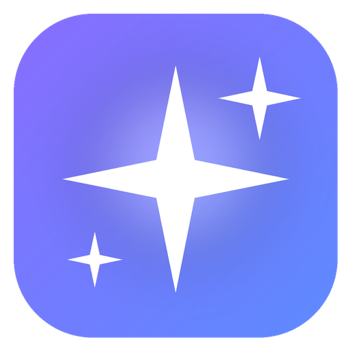

<div align="center">



# LocalAI Studio

**Свой HeyGen + OpusClip + ElevenLabs — полностью на вашем компьютере.**
Изображения · видео со звуком · аватары с синхронизацией губ · перевод и дубляж видео · клипы · клонирование голоса

[English](README.md) · [Установка через ИИ](docs/AI_INSTALL_PROMPT.md) · [Модели](docs/MODELS.md) · [Решение проблем](docs/TROUBLESHOOTING.md)

</div>

---

## ✨ Возможности

| | |
|---|---|
| 🖼️ **Изображения** | Создание (Z-Image Turbo), редактирование по инструкции (Qwen-Image-2.1, FLUX.2 klein), LoRA, улучшение качества, удаление фона |
| 🎬 **Видео** | LTX-2.5 с синхронным звуком, HunyuanVideo 1.5, редактирование видео (Bernini-R, VACE), улучшение, повышение FPS |
| 🧑‍💼 **Аватары** | Говорящие аватары из фото и видео с синхронизацией губ (InfiniteTalk) |
| 🌍 **Перевод и дубляж** | Распознавание → перевод локальной LLM → клонирование голоса каждого спикера → сохранение фоновой музыки → синхронизация губ и субтитры |
| ✂️ **Клипы** | Как OpusClip: находит лучшие моменты, кадрирует в 9:16 по лицу, субтитры по словам, заголовок, экспорт в HD |
| 🎙️ **Голос** | 4 движка, клонирование по 5–15 с, библиотека голосов, «Авто (лучший для русского)» по результатам теста |
| 🧭 **Студия** | Панель «Модели сейчас» с VRAM каждой модели, кнопка «Освободить ОЗУ», история, интерфейс на русском |

Всё работает на `127.0.0.1`: без облака, без аккаунтов, без телеметрии.

---

## ⚠️ Потянет ли мой ПК?

| | Минимум | Рекомендуется |
|---|---|---|
| **Видеокарта** | NVIDIA RTX 20xx+, **8 ГБ** | **NVIDIA RTX 50xx, 16 ГБ** (RTX 5080 / 5090) |
| **Драйвер** | 580+ | последний |
| **ОЗУ** | 16 ГБ | **32 ГБ+** |
| **Диск C:** | 120 ГБ свободно | **300 ГБ**, NVMe SSD |
| **Работает** | изображения + голос (медленно) | всё |

| Видеокарта | Изображения | Голос | Клипы / дубляж | Аватары | Генерация и правка видео |
|---|:-:|:-:|:-:|:-:|:-:|
| 8–11 ГБ | 🟡 медленно | ✅ | ✅ | ❌ | ❌ |
| 12–15 ГБ | ✅ | ✅ | ✅ | 🟡 очень медленно | 🟡 очень медленно / может не хватить памяти |
| 16 ГБ+, RTX 40xx | ✅ | ✅ | ✅ | ✅ | 🟡 LTX-2.5 (NVFP4) не рекомендуется |
| **16 ГБ+, RTX 50xx** | ✅ | ✅ | ✅ | ✅ | ✅ |

> [!WARNING]
> • Видеокарты **AMD / Intel и Mac не поддерживаются** (нужна CUDA).
> • При генерации видео видеокарта работает на 100% минутами: нагрев, шум, 300–450 Вт. Ноутбук — только от сети.
> • Полная установка скачивает **~230 ГБ** моделей (при 100 Мбит/с это 5–6 часов).

Проверить компьютер без установки:
```powershell
powershell -ExecutionPolicy Bypass -File C:\LocalAI\install.ps1 -CheckOnly
```

---

## 🚀 Установка

```bash
git clone https://github.com/Grom1806/localai-studio.git C:\LocalAI
```

1. Дважды щёлкните **`C:\LocalAI\Install-LocalAI.bat`**. Установщик проверит ПК, поставит всё нужное в `C:\LocalAI`
   (в систему ничего не ставится), соберёт окружения по точным версиям, предложит профиль моделей и скачает их.
2. Запустите ярлык **LocalAI Studio** на рабочем столе.
3. Откройте **http://localhost:3000**

| Профиль | Объём | Что входит |
|---|---|---|
| `starter` | ~62 ГБ | изображения, голос, клипы, дубляж, локальная LLM |
| `video` | ~122 ГБ | + видео LTX-2.5 со звуком, аватары |
| `full` | ~231 ГБ | + Qwen-Image, Bernini-R / VACE, HunyuanVideo 1.5, Fish S2 Pro |

Установщик можно запускать повторно: готовые шаги пропускаются, оборванные загрузки продолжаются.

### 🤖 Установка через ИИ-агента

Откройте Claude Code (или другого агента) в папке `C:\LocalAI` и вставьте промпт из
**[docs/AI_INSTALL_PROMPT.md](docs/AI_INSTALL_PROMPT.md)**. Агент сначала проверит мощность ПК и честно скажет,
что на нём не заработает. Он соблюдает строгие правила: не трогает драйверы, BIOS и настройки Windows, качает только из официальных источников и спрашивает перед каждой загрузкой больше 15 ГБ. Все известные ошибки уже описаны в промпте.

---

## 🛡️ Приватность и ответственность

- Клонируйте только свой голос и лицо или те, на которые у вас есть разрешение. Скачивайте только видео, которые вы имеете право использовать.
- У моделей разные лицензии (например, Fish S2 Pro — только некоммерческая), см. [docs/MODELS.md](docs/MODELS.md).

Исходный код LocalAI Studio: [MIT](LICENSE).
